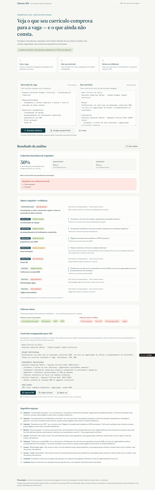

# Clareza ATS

**Currículo fiel. Match explicável.**

Aplicação web educacional para comparar o texto de uma **vaga** com o de um **currículo**, identificar requisitos com e sem evidência textual e reorganizar o currículo para revisão e exportação. Voltada a pessoas que querem verificar se suas experiências estão descritas de forma clara — **sem inventar competências, cargos, certificações ou resultados**.

**[Experimentar o aplicativo](https://clareza-ats-otavio-diniz.lovable.app)** · [Reproduzir o código](docs/guia-reproducao.md) · [Prompt de construção utilizado](docs/mega-prompt-original.md)

> **Demonstração educacional:** o percentual apresentado é uma heurística de cobertura textual. **Não representa nota de ATS, classificação real de candidatos ou previsão de contratação.** Use somente dados fictícios para demonstração.

## Problema

Currículos podem omitir competências relevantes ou descrevê-las de forma pouco evidente diante dos requisitos de uma vaga. A correspondência automática, por sua vez, pode confundir a presença de uma palavra com comprovação de conhecimento ou acrescentar qualificações não declaradas.

**Problema abordado:** como oferecer uma comparação clara, rastreável e conservadora entre a vaga e o currículo, preservando integralmente os fatos fornecidos pela pessoa?

## Solução e fluxo principal

1. A pessoa cola a descrição da vaga e o currículo, ou carrega o **exemplo fictício**.
2. A aplicação identifica requisitos obrigatórios e desejáveis e procura trechos correspondentes no currículo.
3. O resultado apresenta cobertura **heurística**, matriz requisito × evidência, termos encontrados, pontos a verificar e sugestões condicionais.
4. Uma versão reorganizada do texto é oferecida para **revisão e edição humana**, com saída por impressão em PDF, cópia ou TXT.

A ausência de uma competência no texto **não prova que a pessoa não a possui**. Níveis como “Excel avançado” não são inferidos de uma menção genérica a Excel.

## Funcionalidades implementadas

- Campos editáveis de vaga e currículo, validação de conteúdo insuficiente, exemplo e limpeza.
- Classificação de requisitos e matriz com estados **Evidência textual**, **Aderência transferível**, **Revisão necessária** e **Não identificado**.
- Indicador de cobertura de requisitos identificados, com contagens separadas para **obrigatórios** e **desejáveis**.
- Destaque de lacunas essenciais e de palavras-chave presentes/ausentes do texto.
- Recomendações que exigem confirmação humana antes de inserir qualquer experiência.
- Currículo reorganizado em seções simples e **editável**; impressão em A4/“Salvar como PDF”, cópia e TXT.
- Interface em português, responsiva, com componentes acessíveis shadcn/ui e exemplos totalmente fictícios.

Não há login, histórico de candidatos, backend de armazenamento de currículos, assinatura nem integração com ATS reais.

## Estado atual e demonstração

**MVP educacional funcional e publicado em 23/11/2026.** O site público foi aberto sem autenticação e o fluxo com o exemplo fictício foi executado em navegador Chromium. O código está disponível neste repositório para inspeção e reprodução.

No exemplo, a aplicação exibe **4 de 8 requisitos com evidência textual (50%)**, sendo **3/5 obrigatórios** e **1/3 desejáveis**. *Excel avançado* e *Power BI* permanecem destacados para revisão/ausência, sem serem artificialmente inseridos no currículo.

<details>
<summary><strong>Ver captura autêntica da análise publicada (dados sintéticos)</strong></summary>



</details>

A [captura](assets/screenshots/analise-exemplo-ficticio-20261123.png) reproduz o aplicativo real, não uma imagem conceitual. A demonstração é independente de candidaturas ou dados de terceiros.

## Quickstart — do clone ao primeiro uso

Ambiente usado na validação: **Windows**, Node.js **26.13.1** e npm **11.20.0**, com Git e acesso ao registro npm. Outros sistemas/versões não foram homologados.

```bash
git clone https://github.com/otavio-diniz/clareza-ats.git
cd clareza-ats
npm ci --ignore-scripts
npm run dev
```

Abra a URL local exibida no terminal. No aplicativo, use **Carregar exemplo fictício** → **Analisar aderência** → confira a matriz e edite o currículo reorganizado → **Exportar PDF** → escolha *Salvar como PDF* no navegador.

Para instalar, testar, compilar, interpretar saídas esperadas ou resolver problemas, consulte o **[guia de reprodução](docs/guia-reproducao.md)**. Ele é a fonte canônica dos comandos de verificação; o Quickstart acima mantém somente o caminho de primeiro uso.

## Arquitetura, estrutura e tecnologias

| Camada | Implementação |
|---|---|
| Interface e experiência | **React 19**, **TypeScript**, **Tailwind CSS 4**, **shadcn/ui**, Radix e Lucide |
| Roteamento e runtime | **TanStack Router/Start**, **Vite** e **Nitro** |
| Análise | Regras determinísticas em TypeScript: normalização, dicionário de competências e comparação de trechos |
| Currículo | Reorganização conservadora do texto original e edição humana antes da exportação |
| Exportação | CSS de impressão A4 e API de impressão do navegador; TXT e área de transferência |
| Dados | Estado em memória no navegador; **sem banco de currículos** |
| Qualidade | **Vitest**, ESLint, TypeScript e auditoria npm |
| Prototipação | **Lovable**, a partir do mega prompt original publicado |

Pontos principais do código: `src/routes/index.tsx` (fluxo), `src/components/ats/` (interface), `src/lib/ats/analysis.ts` (matriz e cobertura), `src/lib/ats/concepts.ts` (regras de competências), `src/lib/ats/resume.ts` (saída), `src/lib/ats/sample.ts` (dados fictícios) e `src/lib/ats/analysis.test.ts` (testes).

A análise é **baseada em regras**, não em um modelo externo que avalia currículos. Nenhum requisito identificado é tratado automaticamente como histórico profissional verdadeiro.

## Testes e evidências

Na revisão GitHub verificada em **23/11/2026**, em ambiente Windows com instalação npm, os resultados observados foram:

| Verificação | Resultado |
|---|---|
| Vitest | **15/15 testes aprovados**, em 2 arquivos |
| ESLint | **0 erros**; 6 avisos Fast Refresh de componentes compartilhados |
| TypeScript | Checagem estática **sem erros** |
| Build | **Concluído** para cliente, SSR e Nitro |
| Auditoria npm | **0 vulnerabilidades reportadas** nas dependências analisadas naquele momento |
| Navegador público | Fluxo do exemplo fictício, análise 50%, matriz e edição disponível |
| Impressão | PDF de exemplo gerado no Chromium; inspeção visual integral de suas páginas não foi documentada |

Esses resultados dizem respeito aos **testes e ambientes especificados**, não constituem garantia universal de portabilidade, acessibilidade, conformidade LGPD ou ausência de qualquer vulnerabilidade. A revisão de dependências do **GitHub** e o snapshot de hospedagem do **Lovable** são cadeias distintas; não se afirma identidade binária entre elas.

Detalhes e motivos das escolhas: [engenharia de prompts, decisões e validação](docs/decisoes-e-validacao.md).

## Segurança, privacidade e limitações

- **Privacidade do MVP:** comparação realizada no navegador, sem autenticação nem persistência de currículos em banco. A infraestrutura de hospedagem e fontes de terceiros podem registrar metadados técnicos usuais.
- **Fidelidade curricular:** nenhuma lacuna deve ser preenchida por suposição. Cabe ao usuário conferir afirmações, formatação e o PDF antes de enviar a recrutadores.
- **Limites da heurística:** palavras não provam experiência; nem todas as expressões, níveis ou sinônimos são interpretados corretamente. A ferramenta não é validada contra sistemas ATS de empresas.
- **Qualidade e segurança:** testes de lógica e navegador não substituem auditoria integral de privacidade, segurança, acessibilidade com leitores de tela ou testes em todos os dispositivos físicos.

Para demonstrar ou relatar falhas, **não informe currículos, vagas confidenciais ou dados pessoais reais**.

## Engenharia de prompts e aprendizados

O produto começou com um [mega prompt em Markdown, efetivamente enviado ao Lovable](docs/mega-prompt-original.md): fluxo completo, design shadcn/ui, cores, tratamento de requisitos, fidelidade factual, dados sintéticos, exportação e critérios de teste.

Após a primeira geração, as mudanças **comprovadamente realizadas no código GitHub** foram correção de estilo/portabilidade, gerenciamento reprodutível de dependências e tratamento de advisories, além da apresentação profissional. Essas modificações não são apresentadas como mensagens adicionais enviadas ao agente Lovable. As decisões, diferenças de distribuição e verificações estão descritas em [decisões e validação](docs/decisoes-e-validacao.md).

**Aprendizado central:** uma “porcentagem de match” só é útil se o visitante consegue inspecionar a evidência, entender as lacunas e corrigir a apresentação **sem inventar fatos**.

## Evoluções possíveis — não implementadas

Análise semântica mais abrangente e auditável; download DOCX; testes com leitores de tela e dispositivos móveis físicos; melhorias de paginação do PDF e versões de currículo. Estas são possibilidades futuras, não capacidades prometidas ou medidas.

## Contexto acadêmico e reconhecimento

Projeto independente do desafio **“Gerador de Currículos ATS Friendly”**, no curso **Santander — Construa seu Primeiro App com IA**, da **[DIO — Digital Innovation One](https://github.com/digitalinnovationone)**, com reconhecimento ao **[Santander Open Academy](https://www.santanderopenacademy.com/pt_br/index.html)** pelas referências e pelo contexto de aprendizagem. **A menção não implica parceria, endosso, certificação, vínculo ou aprovação institucional deste produto.**

## Autoria, licença e feedback

**© 2026 Otávio Diniz. Direitos reservados sobre os materiais autorais próprios**, respeitados os direitos de componentes de terceiros. A divulgação pública permite demonstração e avaliação na extensão definida em [LICENSE](LICENSE); **não constitui licença open source de reutilização irrestrita**.

Proveniência, marcas e direitos de terceiros: [NOTICE.md](NOTICE.md). Para relatar defeitos, sugerir correções ou colaborar com evidências sintéticas: [CONTRIBUTING.md](CONTRIBUTING.md).
